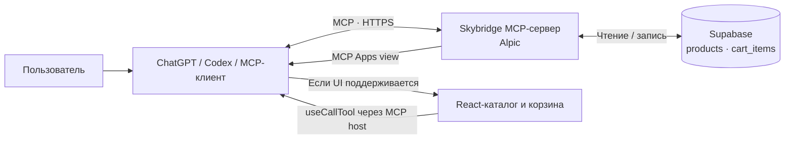

# Shopping Cart MCP

Интерактивное MCP-приложение для поиска товаров, управления демо-корзиной и планирования покупок по бюджету.

Проект разработан как frontend/MCP-тестовое задание. Он объединяет шесть MCP-инструментов, React-интерфейс, Agent Skill shopping-assistant и удалённое хранение данных в Supabase. Сервер развёрнут на Alpic и доступен без запуска локального компьютера.

Версия переносимого плагина: **1.0.2** · Коммит комплекта сдачи: [`d742b4c`](https://github.com/SAGOMADGE/MCP-Testing/commit/d742b4c94cbf4264a8aa9c7dcb36d37be84111ac) · Стек: TypeScript, React, Skybridge 2, Zod, Supabase, Alpic

[Открыть Playground](https://mcp-testing-5679d679.alpic.live/try) · [MCP endpoint](https://mcp-testing-5679d679.alpic.live/mcp) · [**Инструкция для проверяющего**](docs/README-NUGZAR.md) · [**Результаты тестирования**](docs/VALIDATION.md)

Демо-проект: корзина общая для всех подключённых пользователей. Здесь нет персональных аккаунтов, оформления заказов или оплаты. Вызовы добавления, изменения количества и удаления действительно изменяют общую демо-корзину.

## Возможности

| Функция | Что реализовано |
|---|---|
| Каталог | Получение до 20 товаров из Supabase, отображение карточек с изображением, названием и ценой |
| Поиск и фильтры | Поиск по названию, фильтрация по категории и максимальной цене в React |
| Подробности | Описание товара и до трёх похожих товаров из той же категории |
| Корзина | Просмотр общей корзины, добавление товара, изменение количества, удаление, подсчёт суммы |
| Scenario Modeler | Сравнение экономного, сбалансированного и премиального наборов по выбранным категориям и бюджету |
| Agent Skill | Инструкции для AI о выборе инструментов, подтверждении операций и безопасной работе с общей корзиной |
| MCP Apps UI | Интерактивный каталог внутри клиентов, поддерживающих отображение MCP Apps |

Scenario Modeler не изменяет корзину. Он выбирает по одному товару на категорию: самый дешёвый, средний элемент списка по цене или самый дорогой. Затем сравнивает стоимость готовых наборов с бюджетом. Это не оптимизатор произвольных комбинаций.
## Как попробовать

Без локального запуска: откройте Alpic Playground или подключите удалённый MCP-сервер к поддерживаемому клиенту.

Для проверки через ChatGPT или Codex:

1. Получите архив shopping-cart-handoff-1.0.2.zip из комплекта сдачи и распакуйте его.
2. Следуйте инструкции для своей среды: [ChatGPT](docs/INSTALL-CHATGPT.md) или [Codex](docs/INSTALL-CODEX.md).
3. Начните с запроса только на чтение: «Покажи каталог товаров. Корзину не изменяй».
4. Проверьте подробности товара, фильтры, Scenario Modeler и просмотр корзины.

Важно: наличие установленного плагина ещё не гарантирует доступность MCP-инструментов и React UI в конкретном клиенте. Проверена установка плагина через локальный Codex marketplace из распакованного комплекта, обнаружение установленного Skill и вызов MCP-инструмента `get-products`. Импорт переносимого ZIP на другом ChatGPT-аккаунте требует отдельной проверки. В терминальном Codex CLI визуальный React-интерфейс не гарантируется.

## Архитектура



Как это работает: MCP-клиент вызывает инструмент, сервер Skybridge обращается к Supabase и возвращает структурированные данные. Для get-products сервер дополнительно объявляет React view products; совместимый хост может отобразить интерактивный UI. Из UI следующие операции инициируются через useCallTool, а не прямым доступом к базе данных. Ключ Supabase остаётся на стороне сервера.

Основные файлы:

```text
src/
  server.ts                       # Регистрация MCP Tools, Zod и Supabase
  index.ts                        # Запуск Skybridge
  helpers.ts                      # Типизированные React-хуки MCP
  views/products.tsx              # Главный React-каталог и состояние UI
  components/                     # Карточки, фильтры, корзина, планировщик
  lib/scenario-modeler.ts         # Расчёт трёх сценариев без записи в БД
  skills/shopping-assistant/SKILL.md
plugins/shopping-cart/            # Переносимые манифесты и Agent Skill
scripts/                          # Проверки, синхронизация, упаковка
```

Подробнее: [архитектура и форматы плагина](docs/ARCHITECTURE.md).

## Шесть MCP-инструментов

| Tool | Входные данные | Результат | Действие |
|---|---|---|---|
| `get-products` | — | До 20 товаров; связанный React-каталог | Только чтение |
| `get-product-details` | `productId` | Описание и до 3 похожих товаров | Только чтение |
| `get-cart` | — | Товары и количества общей корзины | Только чтение |
| `add-to-cart` | `productId`, `quantity` | Добавляет товар; для существующего увеличивает количество | Запись |
| `update-cart-item` | `productId`, `quantity` | Устанавливает итоговое, а не добавочное количество | Запись |
| `remove-from-cart` | `productId` | Удаляет товар из общей корзины | Запись |

На сервере параметры проверяются с помощью Zod. Данные возвращаются в structuredContent и текстовом content; React использует типизированные хуки useToolInfo и useCallTool. Операции записи следует выполнять только по явному запросу пользователя и проверять последующим get-cart.
## Локальная разработка

Требования: Node.js 24+, npm и доступ к существующим Supabase-настройкам.

```sh
npm ci
```

Создайте локальный `.env` (не коммитьте его в Git):

```dotenv
SUPABASE_URL=<your-supabase-url>
SUPABASE_SECRET_KEY=<your-server-side-secret>
DEMO_CART_ID=<your-demo-cart-id>
```

Затем запустите dev-сервер:

```sh
npm run dev
```

В стандартной локальной конфигурации Skybridge доступен по http://localhost:3000/mcp, а DevTools — по http://localhost:3000/. В PowerShell при блокировке npm.ps1 можно использовать npm.cmd.
## Проверки

```sh
npm run build            # Production-сборка; генерирует типы Skybridge
npm run typecheck        # Проверка TypeScript
npm test                 # Изолированные тесты Vitest
npm run build:check      # Проверка артефактов сборки
npm run plugin:check     # Согласованность манифестов и Skill
npm run test:remote      # Read-only проверка удалённого MCP
npm run package:delivery # Создание архивов в artifacts/
```

Опциональная проверка установленного Codex CLI: `npm run test:codex`.

Отчёт на 21 ноября 2026: 14/14 тестов PASS (9 серверных, 2 для Scenario Modeler и 3 React). Регрессионные React-тесты проверяют независимый статус «Добавляем...» для разных productId, защиту от повторного клика и восстановление кнопок после ошибки. Тесты используют mock-данные и не изменяют production-корзину. Typecheck и production build также прошли; детали, границы проверок и неподтверждённые сценарии перечислены в [VALIDATION.md](docs/VALIDATION.md).
## Плагин и Agent Skill

В комплекте поставляются plugin.json, mcp.json, совместимые настройки Codex и skills/shopping-assistant/SKILL.md. Skill описывает, как агенту работать с инструментами; саму работу с товарами выполняют MCP Tools на сервере. Наличие Skill в серверных исходниках не равнозначно установке Skill в конкретном клиенте.

package:delivery формирует:

- shopping-cart-1.0.2.zip — переносимый пакет плагина;
- shopping-cart-handoff-1.0.2.zip — основной комплект для проверяющего: плагин, Skill, Codex marketplace и документация;
- shopping-cart-source-1.0.2.zip — исходный код без секретов и персональных App ID;
- SHA256SUMS.txt и package-report.json — контрольные суммы и отчёт упаковки.

Для сдачи передавайте `shopping-cart-handoff-1.0.2.zip`. Для импорта плагина нужен вложенный `shopping-cart-1.0.2.zip`, а не весь handoff. Архивы генерируются локально в `artifacts/` и не являются частью опубликованного GitHub-репозитория.

## Ограничения демоверсии

- Общая корзина: один серверный DEMO_CART_ID для всех клиентов, без изоляции пользователей и OAuth.
- Не production-магазин: отсутствуют регистрация покупателей, checkout и обработка платежей.
- Параллельные записи: последовательность «прочитать количество → upsert» в add-to-cart не гарантирует атомарное суммирование при одновременных запросах разных клиентов.
- Совместимость клиентов: доступность React UI и установленного Skill зависит от возможностей и настроек хоста. Установка на аккаунте получателя, мобильные клиенты и Claude не прошли отдельную приёмку.
- Сценарии: Scenario Modeler работает только в React и не меняет корзину; это не отдельный MCP-инструмент.

## Документация

| Файл | Для чего |
|---|---|
| [README-NUGZAR.md](docs/README-NUGZAR.md) | Краткая инструкция по приёмке для Нугзара |
| [INSTALL-CHATGPT.md](docs/INSTALL-CHATGPT.md) | Установка в ChatGPT и резервный маршрут подключения |
| [INSTALL-CODEX.md](docs/INSTALL-CODEX.md) | Установка в Codex и диагностика |
| [ARCHITECTURE.md](docs/ARCHITECTURE.md) | Архитектура, форматы плагина и подтверждённые источники |
| [VALIDATION.md](docs/VALIDATION.md) | Реальные результаты и ограничения тестирования |
| [RELEASE.md](docs/RELEASE.md) | Финальная упаковка, GitHub и Alpic deployment |

[Репозиторий: SAGOMADGE/MCP-Testing](https://github.com/SAGOMADGE/MCP-Testing) · [Демонстрация: Alpic Playground](https://mcp-testing-5679d679.alpic.live/try)
